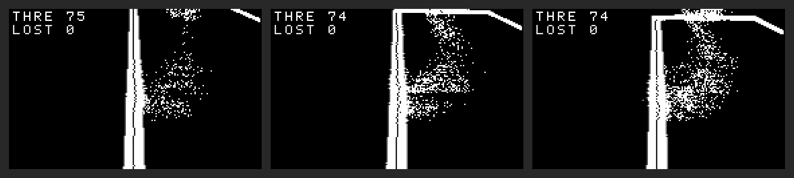
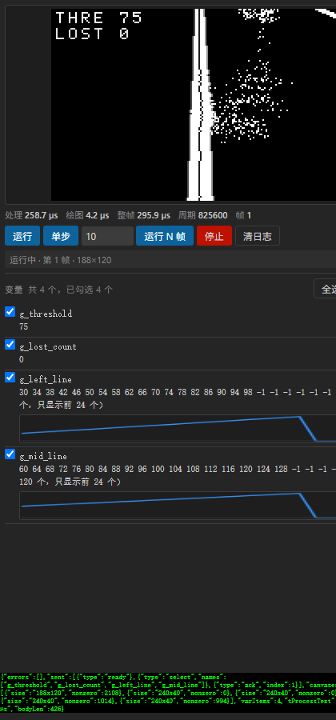

# SCUT-71 Vision Studio

> 智能车视觉仿真环境 · **VS Code 插件形态** · 上手即用

**代号**：`SCUT-71-vision-studio`
**状态**：核心可运行、构建链路已打通、插件已装进 `71-Vision` profile

---

## 一句话目标

> 用户**只写自己的视觉算法**，仿真、编译、调试、可视化全部自动就位。

---

## 现在能做什么（已实测）

| 能力 | 状态 |
|---|---|
| 用户写零行注册代码，环境自动发现全部全局变量（含 `static`） | ✅ 实测 35 变量 × gcc/clang 全部正确 |
| 构建：环境库 + 用户代码 + 后端，一键完成 | ✅ 实测（含空格+中文路径） |
| 仿真运行：加载真实测试图、逐帧推进、输出图像与变量 | ✅ 实测 36 帧全部非黑 |
| 彩色调试标注（点/线/框/文字）合成进输出图 | ✅ 实测红绿蓝三线 + 文字 |
| headless 后端（无窗口批处理 / CI） | ✅ 可运行 |
| 变量选择（只输出关心的那几个） | ✅ `--select` |
| 单步一帧（供 IDE 逐步调试） | ✅ `--step` |
| VS Code 插件编译、打包、装入 profile | ✅ 已装进 `71-Vision` |
| **Webview 仿真视图 + 变量面板 + 曲线** | ✅ **真实 Chromium 渲染验证** |
| **调试：断点/调用栈/读变量** | ✅ **真实 DAP 会话验证（15/15）** |

**视觉证据**（headless 三帧连跑，真实赛道图）：



**Webview 面板**（真实 Chromium 渲染同一份前端资源）：



> 面板里可以看到：帧图像、`THRE 75 / LOST 0` 调试文字、计时读数、
> 工具栏、4 个变量勾选框（带真实数值、截断提示）、以及由数组画出的曲线。

> 图中文字是环境**内置 8×8 字库**渲染的，彩色标注来自核心 —— 全部不依赖任何图形库。
> 三帧分别是 `pic/1/1.bmp`、`2.bmp`、`3.bmp`，可见 `--advance` 生效。

---

## 快速开始

### 1. 环境（已就绪）

| 组件 | 位置 |
|---|---|
| LLVM-MinGW 21.1.1（clang/clangd/lldb-dap + sysroot） | `D:\TOOLS\llvm-mingw` |
| binutils `objdump`（自动发现用，**不能**用 llvm-objdump） | `D:\TOOLS\mingw-w64\bin` |
| Python 3.12 | `D:\TOOLS\anaconda3` |

### 2. 新建工程

```powershell
Copy-Item -Recurse SCUT-71-vision-studio\templates\starter 我的视觉工程
```

工程结构（**只有 `code/` 是你需要改的**）：

```
我的视觉工程/
├── code/camera.c    ← ★ 你唯一要改的文件（名字与真车工程一致，可直接拷上车）
├── config.h         ← 图像尺寸（编译期契约，改完只需重编这一处）
├── pic/1/           ← 你自己的测试图集（模板不附带图，见 pic/1/README-pic.txt）
└── .scut/           ← 生成物（构建缓存、变量清单、帧输出）
```

### 3. 构建

```powershell
python SCUT-71-vision-studio\tools\scut_build.py --project 我的视觉工程 --toolchain D:\TOOLS\llvm-mingw
```

首次构建会连核心库一起编译（约 1.5 秒），之后**改算法不再重编环境**。

环境自检：

```powershell
python tools\scut_build.py doctor --project 我的视觉工程 --toolchain D:\TOOLS\llvm-mingw
```

### 4. 运行

```powershell
cd 我的视觉工程
.scut\bin\scut_sim.exe --frames 36 --advance --out frames
```

| 参数 | 说明 |
|---|---|
| `--frames N` | 跑 N 帧 |
| `--advance` | 每帧切换到下一张测试图（到末尾回卷） |
| `--step` | 每帧后等一行输入（IDE 单步用） |
| `--json` | stdout 输出机器可读协议（进度走 stderr） |
| `--select A,B` | 只输出这两个变量 |
| `--list-vars` | 列出自动发现的变量后退出 |
| `--pic DIR` / `--frame N` | 指定图集 / 起始张号 |

---

## 写你的算法

**你不需要写 `main()`** —— 环境已经有了。你只需要注册回调：

```c
#include "scut_sdk.h"

/* 这些变量【不用注册】，环境会自动发现并列进变量面板 */
int g_threshold     = 0;
int g_left_line[SCUT_IMAGE_H];
static int s_histogram[256];      /* static 也能被发现 */

static void my_process(void)
{
    const scut_u8 *img;
    int w, h;

    img = SCUT_GetInputImage(&w, &h);   /* 只在 PROCESS 阶段有效 */
    if (!img) return;

    /* ... 你的算法 ... */

    SCUT_OutImageSet(x, y, value);      /* 写结果图（灰度） */
}

static void my_draw(void)               /* 不计入处理时间 */
{
    SCUT_DrawPoint(x, y, SCUT_COLOR_RED);
    SCUT_DrawText(2, 2, SCUT_COLOR_WHITE, "THRE %d", g_threshold);
}

static void my_report(void)             /* 不计入处理时间 */
{
    SCUT_Log(SCUT_LOG_INFO, "阈值=%d", g_threshold);
}

/* 一条语句注册，可放在任意文件的任意位置 */
SCUT_REGISTER(SCUT_ROLE_PROCESS, 100, "my_process", my_process)
SCUT_REGISTER(SCUT_ROLE_DRAW,    100, "my_draw",    my_draw)
SCUT_REGISTER(SCUT_ROLE_REPORT,  100, "my_report",  my_report)
```

### 角色与计时口径

| 角色 | 何时调用 | 计时 |
|---|---|---|
| `INIT` | 开机一次 | **不计** |
| `PRE_FRAME` | 每帧处理前 | 计 |
| `PROCESS` | 图像处理主体 | **计（这是"处理时间"）** |
| `POST_FRAME` | 每帧处理后 | 计 |
| `DRAW` | 绘制标注 | **不计** |
| `REPORT` | 输出 LOG | **不计** |
| `SHUTDOWN` | 退出清理 | 不计 |

> **为什么绘制不计时**：车载程序上没有"画点给屏幕看"这件事，
> 算进去会让性能数据失真。但绘图仍是真实开销，所以单独给出 `draw_us`。

> **优先级必须显式写**：跨编译单元的构造函数执行顺序是**未定义**的
> （实测 GCC 下甚至是逆序）。环境按 `(role, priority, name)` 稳定排序，
> 所以回调之间有依赖时，靠优先级表达，不要靠书写顺序。

---

## 目录结构

```
SCUT-71-vision-studio/
├── core/                环境核心（预编译成静态库，config-agnostic）
│   ├── include/         公开头文件（scut_sdk.h 是用户唯一要看的）
│   └── src/             实现：注册表 / 调度 / 绘制 / 帧 / 日志 / 输入
├── bind/                ★ 唯一知道编译期尺寸的地方（Bind TU）
├── backends/
│   └── headless/        无窗口后端
├── extension/           VS Code 插件（TypeScript）
├── tools/
│   ├── scut_symbols.py  ★ 自动符号发现（DWARF）
│   └── scut_build.py    构建编排
├── templates/           新建工程模板
│   ├── starter/         code/camera.c + config.h（故意不含测试图）
│   └── README-pic.txt   测试图集放法说明（新建工程时拷进 pic/1/）
├── tests/               回归测试（fixtures/pic/1/ 存真实测试图）
└── docs/                计划书 / 实测证据 / 插件技术要点
```

---

## 关键设计决策

| 决策 | 内容 | 为什么 |
|---|---|---|
| **库方向反转** | 环境做 `.a`，用户代码做 `.o` | 消除 `--whole-archive` 地雷；改算法不重编环境 |
| **Bind TU** | 唯一知道编译期尺寸的编译单元 | C 里数组大小必须是编译期常量，这是绕不过的 |
| **包装单元** | `user.wrapped.c` 先 `#include` 用户源码再注册 | 只有这样才够得着 `static` 变量 |
| **绘制下沉核心** | 绘制写进覆盖层，调度器负责合成 | 否则换个后端，标注就**静默消失**（旧环境栽在这） |
| **去除 EasyX** | 改用内置 BMP 解码 | EasyX 要求手动拷库进编译器目录，是最大的上手摩擦 |
| **clangd 而非 cpptools** | Apache-2.0 WITH LLVM-exception | cpptools 许可证限制「只能配微软产品」，不能随插件分发 |
| **QEMU 留接口** | 时钟源抽象成接口 | 确定性计时代价大，先做 `-O0`/`-O2` 双档对照 |

---

## 已知边界（不隐藏）

1. **"整帧耗时"不含呈现本身**。后端抓帧的开销单独扣除，避免"后端越慢算法看着越慢"。
2. **仿真 ≠ 真机性能**。默认 `-O0`（可调试）；真机是 `-O2`/`-Os`。
3. **只有被使用过的变量才会出现在面板里**。从未被引用的 `static` 会被编译器整个删除（clang 尤其积极），这与调试器行为一致。
4. **PNG/JPEG 暂不支持**，目前只认 BMP（`stb_image` 集成是后续工作）。
5. **中文文字不支持**（内置 8×8 ASCII 字库），会渲染成占位方框。
6. **C 语言无法 100% 阻止蓄意绕过**防呆（可以直接访问全局数组），但访问器能挡住无意误用。

---

## 测试

> **一条命令跑完全部**（推荐）：

```powershell
python tests\run_all_tests.py --also-cn
```

当前结果：**6/6 通过**（含空格 + 中文路径）。分项：

| # | 测试 | 内容 |
|---|---|---|
| 1 | `test_symbols.py` | 自动符号发现，35 变量 × gcc + clang |
| 2 | `check_json_protocol.py` | 仿真输出是严格合法 JSON |
| 3 | `extension_smoke.js` | 插件协议解析 / PGM / 诊断，42 项 |
| 4 | `dap_smoke.js` | **真实 DAP 调试会话**，15 项 |
| 5 | `webview_render.js` | **真实 Chromium 渲染** Webview 前端 |
| 6 | 中文路径端到端 | 同上协议测试跑在含中文+空格的路径上 |

---

## 许可

GPL-3.0（沿用原仓库）。LLVM 相关组件为 Apache-2.0 WITH LLVM-exception。
